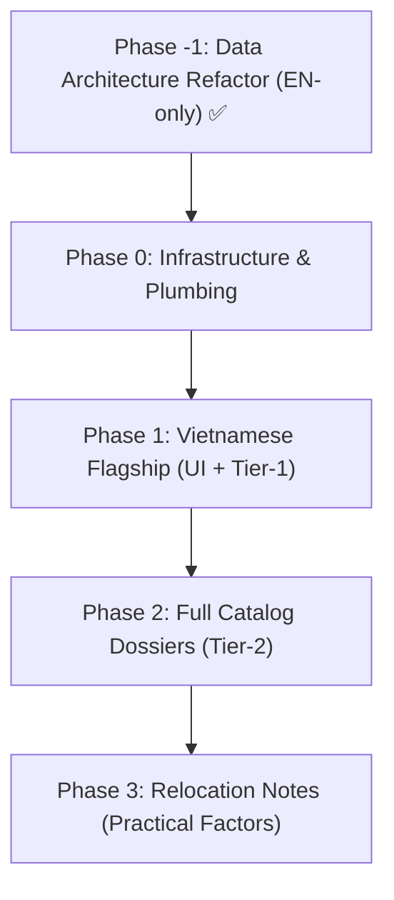

# i18n Plan

**Status:** Phase 0 complete (2026-11-27) — ready for Phase 1
**Scope:** English + Vietnamese first; other languages later
**Updated:** 2026-11-27

This document defines the architecture, content storage, and phased execution plan for multi-language support in Find My Ideal Country.

---

## 1. Summary

Adding Vietnamese means translating two very different layers:

1. **UI + quiz strings** (~250 strings) — small, mechanical, code-level dictionary lookup.
2. **The country dataset prose** (~4,000 strings) — the app's core substance and primary translation workload.

### Sequence & Phasing Overview

A key architectural finding is that **a data refactor of the English country dataset is an essential prerequisite (Phase -1)**. Attempting to add Vietnamese against the legacy structure would duplicate machine metadata, create asymmetric directory trees between English and Vietnamese, and complicate QC validation.

The execution sequence is:
- **Phase -1: Data Architecture Refactor (English-only prerequisite)** — ✅ Complete. Unified Tier-1 and Tier-2 prose into a single schema across all 200 countries, merged `dailyRhythm` and `profileSections`, stripped prose from metadata, and aligned the QC script.
- **Phase 0: Infrastructure & Plumbing** — Astro built-in routing (`/en/` and `/vi/`), isomorphic `t()` dictionary, app boot locale preload, and locale-aware profile assembler.
- **Phase 1: Vietnamese Flagship (~800 strings)** — UI chrome, quiz, country exonyms, climate composers, and 22 Tier-1 country dossiers.
- **Phase 2: Full Catalog Dossiers (~2,500 strings)** — All 178 Tier-2 country profiles and regional templates.
- **Phase 3: Relocation Notes (~1,000 strings)** — Hedged notes in `practicalFactors.ts` and `socialWarmth.ts`.

---

## 2. What Text Exists, and Where

Three distinct layers:

### Layer 1 — UI Chrome (~150 strings)

- Static markup in `.astro` shells: `src/components/{Header,CountryPanel,QuizModal,AuthorModal,MapContainer,Toast}.astro` (search placeholder, panel/modal titles, aria labels, author copy — ~32 strings).
- Inline strings inside script template literals:
  - `src/scripts/quiz.ts` — result cards ("You Should Live in…", "Compare top two", "Download persona card", …).
  - `src/scripts/dossier.ts` — section headings ("Practical relocation factors", "Learn more about…"), climate badge labels.
  - `src/scripts/search.ts`, `src/scripts/map.ts`, `src/scripts/toast.ts`.
- `src/layouts/Layout.astro` — `<title>`, meta description, `<html lang>`.

### Layer 2 — Quiz Content (~90 strings)

`QUIZ_QUESTIONS` in `src/data/countries.ts`: 9 questions × (question, subtitle, stageName, ~5 options × label/desc).
Translates cleanly without logic impact: quiz scoring matches on machine `value` enums (`'public'`, `'remote'`, …), never on presentation labels.

### Layer 3 — Country Prose (~4,000 strings)

| Entity | Entries | Prose Strings Each | ≈ Total |
| :--- | :--- | :--- | :--- |
| Flagship (Tier-1) Profiles | 22 | 13 (tagline, realityCheck, culture, people, costOfLiving, workday, evening, 3 upsides, 3 downsides) | ~290 |
| Catalog (Tier-2) Profiles | 178 | 13 (same schema as Tier-1) | ~2,300 |
| Relocation notes (`practicalFactors.ts`) | ~200 | Up to 6 hedged notes | 1,000 |
| Social warmth notes (`socialWarmth.ts`) | 200 | 1 newcomer note | 200 |
| Regional template fallbacks | 5 regions | 13 template strings | 65 |
| Country display names / exonyms | 200 | 1 display name | 200 |

### What Translates for Free (Zero Data Changes)

- `climateProfiles.ts` (200 entries): categorical enums + integer ranges — zero translation needed. Only the badge generator `describeClimateProfile()` in `src/data/climateProfiles.ts` needs a localized label lookup.
- All `dimensions` / lifestyle score numbers and enums.
- Scoring fractions like `"9.2 / 10"` work as-is.

---

## 3. Architecture & Design Decisions

### 3.1 Routing — Astro Built-in i18n

Configure Astro's native i18n in `astro.config.mjs`:

```js
export default defineConfig({
  i18n: {
    defaultLocale: 'en',
    locales: ['en', 'vi'],
    routing: {
      prefixDefaultLocale: true,
      redirectToDefaultLocale: true,
    },
  },
});
```

- Generates `/en/` and `/vi/` pre-rendered static HTML shells with localized `<html lang>`, `<title>`, `<meta name="description">`, and canonical/hreflang tags.
- Root `/` automatically redirects to `/en/` (or browser-preferred locale).
- `src/pages/index.astro` becomes a thin wrapper passing the locale prop into page components.

### 3.2 UI Strings — Isomorphic Typed Dictionary (No Runtime Framework)

```
src/i18n/
  ├── en.ts            # UI dictionary for English
  ├── vi.ts            # UI dictionary for Vietnamese
  ├── countryNames.ts  # Canonical English key -> Vietnamese display name mapping
  └── index.ts         # t(key, vars, locale?) helper
```

- A lightweight typed helper `t(key, vars?, locale?)` with zero external dependencies.
- **Isomorphic execution:**
  - Build-time SSR (Astro components): `t(key, vars, Astro.currentLocale)` directly returns the translated string.
  - Runtime client scripts (`quiz.ts`, `dossier.ts`): reads the active locale initialized on app boot.
- Key parity is verified by a dedicated eval-based test in `scripts/qc-i18n.mjs` (since Vite strips types without typechecking at build time).

### 3.3 Country Data — Unified Schema & Mirrored Trees

#### The Unified Prose Schema
Every country's translatable prose across all 200 countries conforms to a single interface:

```ts
export interface CountryDossierProse {
  tagline: string;
  realityCheck: string;
  culture: string;
  people: string;
  costOfLiving: string;
  workday: string;
  evening: string;
  upsides: [string, string, string];
  downsides: [string, string, string]; // downsides[0] must equal realityCheck
}
```

#### Directory Layout
Prose is stored by locale in mirrored region files, completely separated from machine metadata:

```
src/data/
  ├── content/
  │   ├── en/
  │   │   ├── europe-a.ts
  │   │   ├── asia-a.ts
  │   │   ├── asia-b-oceania.ts
  │   │   ├── africa-a.ts
  │   │   ├── africa-b.ts
  │   │   ├── americas-a.ts
  │   │   ├── caribbean.ts
  │   │   └── index.ts
  │   └── vi/
  │       └── (mirrored structure with same region files, keys, and order)
  ├── countries.ts            # Machine metadata, dimensions, quiz definitions
  ├── globalCountries.ts      # Profile assembler & fallback logic
  ├── climateProfiles.ts      # Climate enums & temperature ranges
  ├── practicalFactors.ts     # Visa/health/safety indicators + notes
  └── socialWarmth.ts         # Warmth levels 1..5 + newcomer notes
```

#### Single Translation Seam & Progressive Fallback
`getCompleteCountryProfile(name, fallbackRegion, centroid, locale = 'en')` in `src/data/globalCountries.ts` acts as the single seam:
- Look up prose from `CONTENT[locale][name] ?? CONTENT['en'][name]`.
- Field-level fallback ensures that any country not yet translated in Vietnamese renders its English prose seamlessly without crashing or leaving blank sections.

### 3.4 Client Hydration & Synchronous Assembly

- **The Problem:** Dynamically importing Vietnamese chunks must not turn synchronous UI methods (`selectCountryByName()`, `getCountryProfile()`) into `async` calls that cascade promises through `map.ts`, `search.ts`, and `dossier.ts`.
- **The Solution:** App Boot Preload in `src/scripts/app.ts`:
  ```ts
  const currentLocale = document.documentElement.lang || 'en';
  await initLocale(currentLocale); // dynamic import happens once here before setup
  initWorldMap();
  initSearch();
  initQuiz();
  ```
- Subsequent calls to `getCompleteCountryProfile()` stay 100% synchronous in memory.
- English users never download the Vietnamese chunk.

### 3.5 Search & Vietnamese Diacritic Folding

- Canonical IDs (`Japan`, `Vietnam`) remain the internal lookup key and TopoJSON link everywhere.
- Search indexes both canonical names, English aliases, and Vietnamese display names (e.g. `Áo` and `Austria`).
- **Accent-insensitive search:** Vietnamese users often type without accents (`nhat ban` instead of `nhật bản`). `src/scripts/search.ts` folds diacritics before query matching:
  ```ts
  function foldDiacritics(str: string): string {
    return str
      .normalize('NFD')
      .replace(/[\u0300-\u036f]/g, '')
      .replace(/[đĐ]/g, (m) => (m === 'đ' ? 'd' : 'D'))
      .toLowerCase();
  }
  ```

### 3.6 Font Subsets

- Verify Google Sans Text in `src/layouts/Layout.astro` renders all Vietnamese diacritics cleanly (`ệ`, `ỗ`, `ự`, `ậ`).
- Ensure font stylesheet request includes necessary unicode glyphs/subsets without unexpected system font fallback.

---

## 4. Translation Storage & Workflow

### UI & Quiz
Stored directly in `src/i18n/{en,vi}.ts` and `src/data/quiz/{en,vi}.ts`. Parity is enforced by automated script.

### Country Prose (Batch Workflow)
Following the project's proven 2026-11 batch workflow:
1. **Export:** A script exports flat handoff sheets per region (`key | field | English | target`).
2. **Translate:** MT draft (LLM or Google Translate) + human review for tone, quote rules, and accuracy.
3. **Validate:** A pre-merge check verifies:
   - Key parity and order.
   - Quote rules (typographic apostrophes `’`, straight quotes for strings, zero double quotes in prose).
   - Character budgets (scaled for Vietnamese).
   - Verbatim check: `downsides[0] === realityCheck`.
   - Mandatory fixed wording (e.g. standard disclaimer translations).
4. **Merge & Gate:** Writes into `src/data/content/vi/{region}.ts` and runs QC scripts and `npm run build`.

---

## 5. QC Script Modernization

`scripts/qc-profile-sections.mjs` is updated to validate the unified `src/data/content/{locale}/*.ts` structure:

- **Self-contained checks:** Because `realityCheck` and `downsides` sit within the same country object, the check no longer requires regex-scraping `globalCountries.ts`.
- **Locale-aware length scaling:** Vietnamese prose runs ~15–25% longer than English. The QC script accepts a `--locale` parameter (delivered in Phase 0):
  - Culture: 250–450 chars (EN), 280–550 chars (VI).
  - People & Cost of living: 200–400 chars (EN), 230–500 chars (VI).
  - Bullets: 30–260 chars (EN), 30–320 chars (VI).
- **Language-specific token bans:** English bans ("hidden gem", "nestled") apply to EN; Vietnamese equivalents apply to VI.
- **Quote & period rules:** Both EN and VI enforce period endings and the ban on double-quote characters.

---

## 6. Detailed Execution Roadmap



### Phase -1 — Data Architecture Refactor (English-only Prerequisite) ✅
*Goal: Eliminate data asymmetry and create a single clean content shape for all 200 countries before introducing i18n.*

**Completed:** 2026-11-27

1. ✅ **Define Unified Prose Schema:** `CountryDossierProse` in `countries.ts`.
2. ✅ **Consolidate Region Prose:**
   - `src/data/dailyRhythm/` and `src/data/profileSections/` merged into `src/data/content/en/{region}.ts`.
   - Tier-1 prose moved out of `COUNTRY_DATABASE` into `content/en/curated.ts`. It was kept as a dedicated flagship file rather than merged into the region files, so tier-1 copy stays easy to locate; it is validated by the same QC checks as the regions.
   - `tagline` and `realityCheck` moved into the unified schema for all 200 countries.
3. ✅ **Clean Metadata:** `COUNTRY_DATABASE` and `GLOBAL_COUNTRY_METADATA` now hold machine fields only. The refactor left ~377 duplicate prose strings behind; those, plus the unused `videos` metadata and `SOCIAL_WARMTH_DESCRIPTORS`, were removed.
4. ✅ **Update Assembler:** `getCompleteCountryProfile()` reads prose exclusively from `CONTENT_EN`.
5. ✅ **Modernize QC:** `qc-profile-sections.mjs` validates all 200 countries across 8 files (7 regions + `curated.ts`), supports `--json`, and exits 1 on errors.
6. ✅ **Tier-1 copy pass (added during completion):** the 22 flagship dossiers now meet the catalog copy rules — culture 258–402 chars, people 218–326, costOfLiving 202–305, and `downsides[0]` equals `realityCheck` verbatim.
7. ✅ **Gate:** all three QC scripts and `npm run build` pass with zero regressions.

---

### Phase 0 — Infrastructure & Plumbing (Zero Translation) ✅
*Goal: Lay the multi-language routing and hydration seams with English fallbacks.*

**Completed:** 2026-11-27

1. ✅ **Astro Configuration:** `i18n` block in `astro.config.mjs` (`/en/`, `/vi/`, `prefixDefaultLocale: true`). Root redirect delivered as a static meta-refresh page in `src/pages/index.astro` (required by Astro i18n) instead of `redirectToDefaultLocale: true` — the built-in redirect route claims `/` and PrerenderRouteConflict-warns against the required index file during static builds; the physical page works on every static host and builds warning-free.
2. ✅ **Page Architecture:** `src/pages/[locale]/index.astro` with `getStaticPaths` (`en`, `vi`) renders the shared shell; `src/pages/index.astro` redirects `/` → `/en/`; `Layout.astro` takes a `locale` prop for `<html lang>`, `<title>`, and a new `<meta name="description">` (canonical/hreflang deferred until a `site` URL is configured).
3. ✅ **Isomorphic UI Dictionaries:** `src/i18n/en.ts` (203 keys, source of truth), `src/i18n/vi.ts` (English placeholder copy, same keys/order), `src/i18n/index.ts` (`t(key, vars?, locale?)`, `tFor(locale)` for SSR, `initLocale`, `localeFromDocument`, `getLocale`), `src/i18n/countryNames.ts` (empty exonym scaffold).
4. ✅ **Script Localization:** all 6 `.astro` shells plus `app.ts`, `dossier.ts`, `quiz.ts` (incl. every scoring reason and the comparison table), `search.ts`, `map.ts`, `author.ts` now resolve through `t()`. `foldDiacritics()` added to `search.ts` (NFD folding + đ/Đ handling).
5. ✅ **Client Hydration Seam:** `app.ts` boot calls `await initLocale(localeFromDocument())` + `await loadContentLocale(locale)` before any UI renders; `getCompleteCountryProfile(name, fallbackRegion?, centroid?, locale?)` and `getAllGlobalCountries(locale?)` fall back per string (`localized ?? english`). Dictionary and prose chunks are dynamic imports — English users never download the `vi` chunks (verified: no `vi` module fetched on `/en/`, both fetched on `/vi/`).
6. ✅ **Empty Mirror Tree:** `src/data/content/vi/` mirrors all 8 region files (empty records) with its own barrel; `src/data/content/index.ts` holds the locale registry (`getContentRegistry`, `loadContentLocale`).
7. ✅ **QC Locale Support:** `qc-profile-sections.mjs --locale en|vi` (invalid locales exit 2) — per-locale length ranges (§5), per-locale token bans, Unicode-aware word tokenization for VI, curly-single-quote ban scoped to EN; `--locale en` output is identical to the pre-Phase-0 baseline (200 countries, all pass). New `scripts/qc-i18n.mjs` enforces en/vi key parity, order, and `{var}` consistency (203 keys, OK).
8. ✅ **Gate:** `npm run build` produces 3 pages (`/`, `/en/`, `/vi/`, no conflict warning); browser pass on both locales — root redirects to `/en/`, `/vi/` boots with `lang="vi"`, full quiz flow (23 questions → results card → comparison → dossier panel) and accent-folded search (`cote d` → Côte d'Ivoire) work with zero page errors; all four QC scripts pass.

---

### Phase 1 — Vietnamese Flagship (~800 strings)
*Goal: The site feels genuinely Vietnamese; all chrome and the 22 flagship country dossiers are fully localized.*

The QC locale gate from Phase 0 is a precondition for 1F. Steps 1A–1E are independent of each other and can be done in any order.

1. **1A — UI chrome:** Translate `src/i18n/vi.ts` for Header, CountryPanel, QuizModal, AuthorModal, Toast, and the Layout title/meta tags. Gate: `qc-i18n.mjs` key parity + `/vi/` renders.
2. **1B — Runtime strings:** Translate the template literals in `src/scripts/` — quiz result cards, dossier section headings and badge labels, search, map, and toast. Gate: visual pass on `/vi/` with no English literals left in the Vietnamese path.
3. **1C — Quiz content:** Split `QUIZ_QUESTIONS` into `src/data/quiz/{en,vi}.ts`, translate labels, descriptions, and stage names, and leave the `value` enums untouched. Gate: identical scoring for a fixed answer set in both locales.
4. **1D — Exonyms & search:** Populate `src/i18n/countryNames.ts` (~45 established exonyms) and verify diacritic folding. Gate: `nhat ban` → Japan, `Áo` → Austria.
5. **1E — Composer labels:** Translate the categorical descriptors in `climateProfiles.ts`, the dossier badges in `dossier.ts`, `SOCIAL_WARMTH_BANDS`, and the `practicalValue()` labels. Gate: visual pass.
6. **1F — Tier-1 dossiers (22):** Batch in five groups — Europe 10 (2×5), Asia 6, Americas 4, Oceania 2. Each batch runs handoff sheet → MT draft → review → merge into `src/data/content/vi/curated.ts` with `downsides[0] === realityCheck` → `--locale vi` QC.
7. **1G — Phase gate:** `qc-profile-sections.mjs --locale vi` + `npm run build` + bundle-size check + visual QA of `/vi/` dossiers.

---

### Phase 2 — Full Catalog Dossiers (~2,500 strings)
*Goal: Full coverage of all 178 Tier-2 countries and fallback templates.*

1. **Batch Generation:** Export handoff sheets for each of the 7 regions.
2. **Translation & Review:** MT draft + review pass per region.
3. **Validation & Merge:** Merge into `src/data/content/vi/{region}.ts` ensuring verbatim `realityCheck === downsides[0]`.
4. **Regional Templates:** Translate fallback strings in `REGIONAL_TEMPLATES`.
5. **Gate:** 200/200 country profiles pass QC under `--locale vi` + bundle size check.

---

### Phase 3 — Relocation Notes (~1,000 strings)
*Goal: Localize the most nuanced, hedged content layer.*

1. **Locked Glossary:** Define standard Vietnamese translations for mandatory honesty phrases:
   - `"not confirmed in this pass"` -> `"chưa được xác nhận trong đợt đối soát này"`
   - `"Not personal advice."` -> `"Không phải tư vấn cá nhân."`
2. **Translate Notes:**
   - Localize notes in `practicalFactors.ts` (visa, healthcare, tax, hazard, air, water).
   - Localize `newcomerNote` in `socialWarmth.ts`.
3. **Gate:** Full build and QC pass across all scripts.

---

## 7. Open Decisions & Strategy

| Topic | Resolution / Strategy |
| :--- | :--- |
| **Root URL (`/`)** | Redirect `/` to `/en/` initially; evaluate auto-redirect via `Accept-Language` headers later. |
| **Mixed Content Fallback** | Silent fallback to English per string; seamlessly supported by `CONTENT['vi'][name]?.tagline ?? CONTENT['en'][name].tagline`. |
| **Cost Notation** | Keep USD range notation (`$1,600 – $2,400/mo`) initially; review Vietnamese currency display in Phase 2. |
| **Country Exonyms** | Use established Vietnamese exonyms for ~45 countries (Pháp, Đức, Ý, Nhật Bản, Hàn Quốc, Úc, Mỹ, v.v.); keep international names for countries without standard Vietnamese exonyms. |
| **Translation Drafting** | Machine-translation (LLM/Google Translate) drafted via structured handoff sheets, human-reviewed for banned tokens and quotes. |

---

## 8. File-Touch Summary

### Phase -1 (Data Refactor) — ✅ Complete
- `src/data/countries.ts` — `CountryDossierProse` defined; prose and `videos` metadata removed from `COUNTRY_DATABASE`.
- `src/data/globalCountries.ts` — prose removed from `GLOBAL_COUNTRY_METADATA`; assembler reads `content/en/` only; dead `videos` construction removed.
- `src/data/content/en/{europe-a,asia-a,asia-b-oceania,africa-a,africa-b,americas-a,caribbean,index}.ts` — consolidated region prose (178 catalog countries).
- `src/data/content/en/curated.ts` — 22 Tier-1 flagship dossiers, expanded to the catalog copy rules.
- `src/data/dailyRhythm/` & `src/data/profileSections/` — removed after consolidation.
- `src/data/socialWarmth.ts` — unused `SOCIAL_WARMTH_DESCRIPTORS` removed.
- `src/scripts/dossier.ts` — Wikipedia link computed from the country name instead of the unused `videos` metadata.
- `scripts/qc-profile-sections.mjs` — validates 200 countries across 8 files; `--json` implemented.

### Phase 0 (Plumbing)
- `astro.config.mjs` — Native i18n configuration.
- `src/pages/index.astro` & `src/pages/[locale]/index.astro` — Localized routing structure.
- `src/layouts/Layout.astro` — `lang`, localized title and meta tags.
- `src/i18n/{en,vi,countryNames,index}.ts` — Isomorphic dictionary and `t()` helper.
- `src/scripts/{app,quiz,dossier,search,map,toast}.ts` — Extract strings to `t()`, diacritic folding in search.
- `src/data/content/vi/` — Mirrored region tree scaffolding.
- `scripts/qc-i18n.mjs` — Key parity checker for UI dictionaries.
- `scripts/qc-profile-sections.mjs` — `--locale` support (content discovery, per-locale ranges and tokens).

### Phase 1 (Vietnamese Flagship)
- `src/i18n/vi.ts` — UI chrome, shared labels, and error/empty states.
- `src/data/quiz/{en,vi}.ts` — Quiz content split and translation (new files).
- `src/i18n/countryNames.ts` — Vietnamese exonyms and search aliases.
- `src/data/climateProfiles.ts`, `src/scripts/dossier.ts`, `src/data/socialWarmth.ts` — Localized composer and badge labels.
- `src/data/content/vi/curated.ts` — 22 flagship dossiers.
